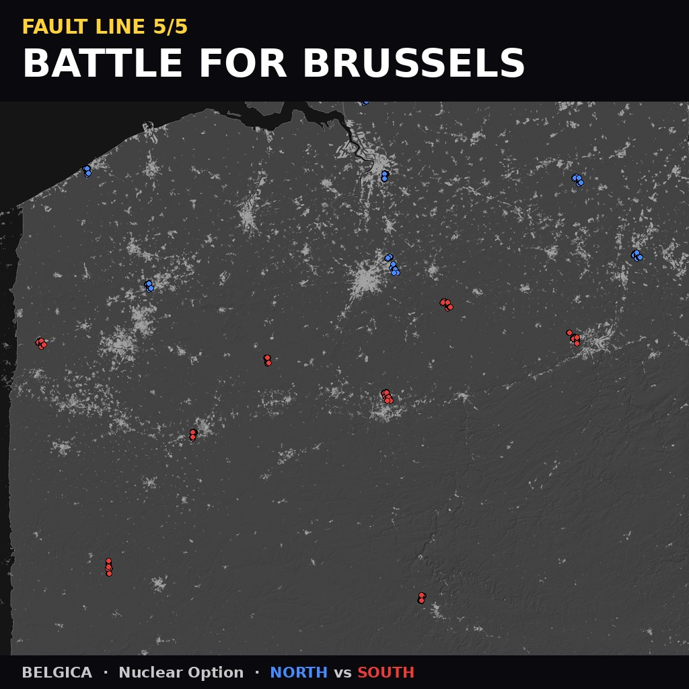

# Belgica: a real-world map of Belgium for Nuclear Option

Belgica is a 261 x 261 km map of Belgium for [Nuclear Option](https://store.steampowered.com/app/2168680), with
the edges of northern France, the south of the Netherlands and a slice of the North Sea. It was made with
[Open Skies](https://github.com/metasprojects/open-skies) from real-world open data: terrain at 30 m, land
cover, towns, about 35,000 km of roads and 16 real airbases.

## Install

**With the Nuclear Option Mod Manager (NOMM):** tick **NOCustomMaps** and **Belgica**. *(Listing pending.)*

**By hand:**

1. Install [BepInEx 5](https://github.com/BepInEx/BepInEx) and
   [NOCustomMaps](https://github.com/metasprojects/NOCustomMaps) 1.4 or later.
2. Download the map from [Releases](https://github.com/therealabradolf/nuclear-option-belgica/releases).
3. Put it in `<Nuclear Option>\BepInEx\plugins\NOCustomMaps\maps\`.
4. Start the game. Belgica is in the Mission Editor's **New** list, and its missions are in your mission list.

Every player in a multiplayer game needs the same build of the map. Don't rebuild it yourself: a rebuild
counts as a different map.

## Airbases

| North (Boscali) | South (Primeva) |
| --- | --- |
| Brussels (EBBR) | Brussels South Charleroi (EBCI) |
| Antwerp Deurne (EBAW) | Liege (EBLG) |
| Ostend-Bruges (EBOS) | Beauvechain (EBBE) |
| Kortrijk-Wevelgem (EBKT) | Chievres (EBCV) |
| Kleine Brogel (EBBL) | Merville-Calonne (LFQT) |
| Maastricht Aachen (EHBK) | Valenciennes-Denain (LFAV) |
| Woensdrecht (EHWO) | Charleville-Mezieres (LFQV) |
| Gilze-Rijen (EHGR) | Peronne Saint-Quentin (LFAG) |

## Missions

The map ships with Open Skies' own Free Flight, Escalation and two Strike missions.

**Fault Line** is a five-mission campaign on Steam Workshop: a fictional war in which the country splits along
the language border. North (Dutch-speaking) flies as Boscali, South (French-speaking) as Primeva. Nuclear
weapons are off in every mission.

1. **Broken Sky**: air strike on the southern air defence network (solo or co-op as the North)
2. **Hainaut Offensive**: southern armoured offensive on the language border (both sides)
3. **North Sea**: amphibious landing at Westende to take Ostend-Bruges (both sides)
4. **Meuse Crossing**: northern counter-offensive on Liege and Vise (both sides)
5. **Battle for Brussels**: every airbase in play (both sides)

The mission files are also in [`missions/`](missions/). Copy each folder to
`%USERPROFILE%\AppData\LocalLow\Shockfront\NuclearOption\Missions\`.

## Build notes

Belgium's road network is so dense that the full network has more records than the NOCustomMaps loader
accepts (108,475 against a limit of 100,000). This build used a patched `pipeline/roads.py`
([`tools/roads-thinning.patch`](tools/roads-thinning.patch)). When a network is over the limit, the patch leaves
out the tertiary roads to towns first. Then, in the densest town centres, it treats secondary roads as
tertiary, so they stay only where they join parts of the network. Belgica keeps every motorway, trunk and
primary road and most secondary roads: 87,194 records, with 99.95% of the network connected.

## Credits

See [CREDITS.txt](CREDITS.txt) for the full data credits and licence notices (Copernicus DEM, ESA WorldCover,
OpenStreetMap / Overture Maps, OurAirports, AWS Terrain Tiles).

This is an unofficial community modification. It is not affiliated with, sponsored by or endorsed by
Shockfront Studios Pty Ltd. It contains no game files. Mods for Nuclear Option may not be sold or put
behind a paywall.
